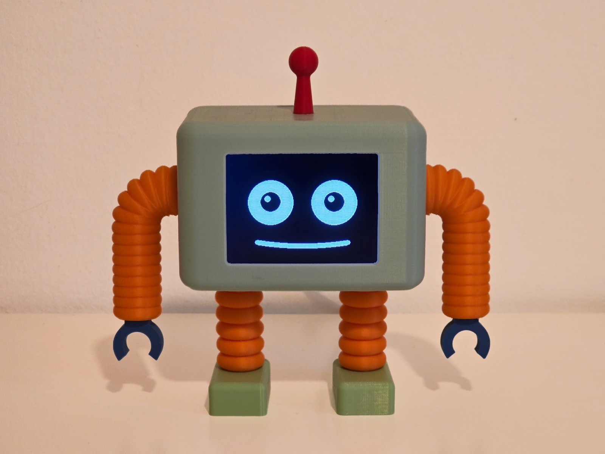

# REX

**A standalone desktop robot with an animated face, full voice conversation,
and a dry, sarcastic AI personality — running entirely on a single
microcontroller, no companion PC.**




Say **"Hey REX"** and just talk to it. No app, no button, no PC — it
listens, thinks, talks back, and reacts on an animated face, powered by an
ESP32 the size of a stick of gum.


*(Full conversation demo: [link to YouTube video here])*

## What it is

REX started as a question: how much "personality" can you fit on a $10
microcontroller? The answer turned out to be: a surprisingly convincing
character — one that wakes up when you say its name, holds a real spoken
conversation, remembers things about you between sessions, checks the
weather or sets a timer when asked, and expresses all of it through a face
made of nothing but two eyes and a mouth, animated from first principles.

Everything — audio capture, wake-word detection, the voice pipeline, face
rendering, and the network calls to Claude — runs on one ESP32-S3. There's
no Raspberry Pi, no laptop in the loop, no cloud dashboard. Unplug it from
WiFi and it still blinks and breathes; plug it back in and it's REX again.

## Features

- **A face built from curves, not sprites** — the mouth is three overlapping
  Gaussian bell curves redrawn every frame from live audio amplitude, so it
  shapes itself to whatever REX is actually saying instead of cycling
  through a fixed set of mouth images. Eyes get idle gaze wander and a slow
  breathing pulse so REX never looks frozen, even in silence. 20+ discrete
  expressions (happy, skeptical, evil, smug, dizzy, and more) layer on top.
- **Hands-free voice conversation** — mic → voice-activity detection →
  speech-to-text → Claude → text-to-speech, with no button required. A
  custom-trained wake-word model ("Hey REX") runs continuously on-device via
  TensorFlow Lite Micro, so REX is always listening for its name without
  ever streaming audio anywhere until it hears it.
- **An actual personality, not a chatbot wrapper** — sarcastic and dry by
  design, with tone that shifts across the day and a persistent memory of
  facts it's picked up about you, carried across reboots.
- **Real tool use** — Claude can reach for live weather and time for any
  city, exact arithmetic, nearby places, sports results, web search, and
  timers REX announces on its own when they're due — the same tool-calling
  pattern production AI products use, running off a microcontroller.
- **Idle behavior** — small ambient fidgets and a drift toward a sleepy
  expression after a few quiet minutes, so an idle REX still feels alive
  rather than paused.

## Gallery

| | | |
|---|---|---|
|  |  |  |


## How it works

```
   mic ──▶ voice-activity   ──▶ speech-to-text ──▶ Claude ──▶ text-to-speech
           detection (VAD)       (streaming)        + tools      │
             ▲                                                   │
    "Hey REX" wake word                                          ▼
     (always listening,                                   animated face
      runs on-device)                                    (eyes + mouth)
```

Two FreeRTOS tasks split the work across the ESP32-S3's two cores: one
drives face rendering and audio capture continuously so the animation never
stutters, while the other handles the network round-trip (STT → Claude →
TTS) so a slow API call can't freeze REX's face. Speech-to-text streams
audio to the transcription API *while the user is still talking*, instead
of waiting for them to finish and uploading the whole clip afterward — it
collapses several seconds of dead air into something closer to real-time.

## Hardware

| Part | Detail |
|---|---|
| MCU | ESP32-S3-WROOM-1 N16R8 (16MB flash, 8MB octal PSRAM) |
| Display | 3.2" ILI9341 SPI, 240×320 |
| Mic | I2S MEMS mic (INMP441-class) |
| Amp + speaker | MAX98357A I2S amp, 4Ω 3W speaker |
| Power | 5V/2A USB-C wall adapter |
| Enclosure | 3D-printed case, exterior USB-C breakout for firmware updates |

The S3 has two independent I2S controllers, so mic capture and speaker
playback run simultaneously with zero contention — one of the reasons it
was chosen over a cheaper single-core alternative.

## Challenges along the way

- **Driver mixup cost a full debugging session.** The display panel looks
  identical to boards that ship with an ST7789 controller, which produces
  garbled, half-correct output if you drive it that way. It's actually an
  ILI9341 — same resolution, different controller, no visible way to tell
  from the board alone.
- **The enclosure changed the acoustics.** Voice-activity detection was
  tuned and working well with the mic exposed on the bench. Once sealed
  into the printed case, the mic hole attenuated incoming audio by roughly
  half, which pushed quiet speech close enough to the silence floor that
  natural mid-sentence pauses started getting misread as the end of an
  utterance. Fixed by re-measuring noise and speech levels *through the
  case* rather than reusing the open-air numbers.
- **Spring physics for the mouth looked wrong.** An earlier version drove
  mouth movement with a physical spring model. It was technically smoother
  but read as mechanical and uncanny — summed Gaussian curves with simple
  linear interpolation ended up looking far more like actual speech.
- **The hardest bug wasn't in any obvious place.** A rare total hang
  turned out to be the ESP32 Arduino core's internal DNS resolver, which
  has its own ~30 second internal timeout that isn't covered by any
  HTTP-client-level timeout setting — invisible until a top-level watchdog
  was added specifically to catch it.

## Tech stack

- **Firmware**: C++17, Arduino framework, [PlatformIO](https://platformio.org/)
- **AI**: [Claude](https://www.anthropic.com/claude) (personality + tool use), OpenAI (speech-to-text), ElevenLabs (text-to-speech)
- **Wake word**: TensorFlow Lite Micro, custom-trained via [microWakeWord](https://github.com/kahrendt/microWakeWord)
- **Display**: [TFT_eSPI](https://github.com/Bodmer/TFT_eSPI)

## Repo layout

- `src/` — all firmware (C++/Arduino, PlatformIO)
- `notebooks/` — the wake-word model training notebook (Colab) and the
  trained model itself
- `media/` — photos and video for this README

## License

MIT — see [LICENSE](LICENSE).
